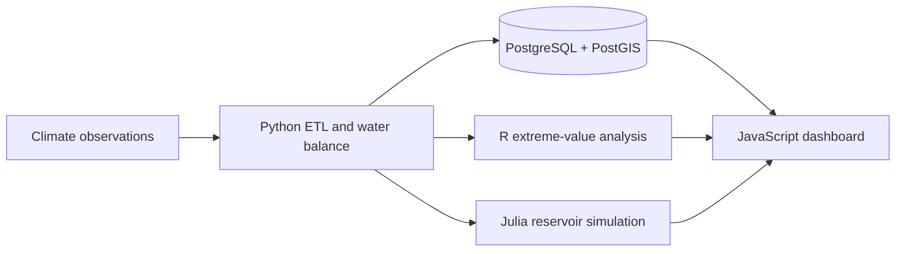

# Architecture

## Design principles

- **Reproducible:** deterministic demonstration data and one-command generation.
- **Spatially ready:** PostGIS geometry, spatial indexes and basin/station relations.
- **Auditable:** quality flags, duplicate constraints and transparent assumptions.
- **Portable:** the web demonstration is static and deploys through GitHub Pages.
- **Extensible:** synthetic inputs can be replaced with SENAMHI, NASA POWER or ERA5 adapters.

## Data flow

1. Python creates or ingests daily climate observations.
2. A conceptual soil-water balance estimates effective rainfall and discharge.
3. PostGIS stores basin geometries, stations and observations.
4. R calculates extreme-flow return levels.
5. Julia evaluates a simplified reservoir rule curve.
6. The browser dashboard explores basin and climate scenarios interactively.

